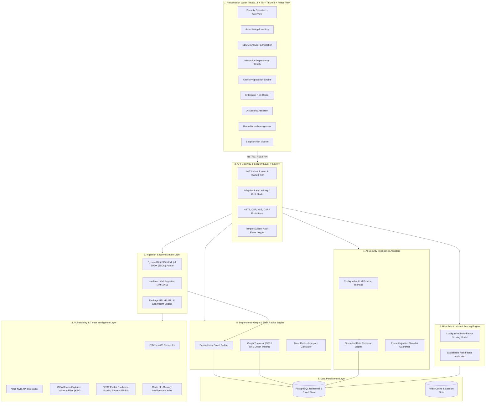

# Supply Chain Sentinel — Architecture & System Design Document
**Product:** SUPPLY CHAIN SENTINEL  
**Tagline:** "See the Risk. Trace the Impact. Stop the Spread."  
**Version:** 1.0.0-Enterprise  
**Classification:** Confidential / Cybersecurity Product Engineering Architecture  

---

## 1. Executive Summary & Problem Space

Modern enterprise software relies extensively on deep dependency trees comprising open-source packages, third-party libraries, container layers, cloud SDKs, and transitive dependencies. Industry telemetry indicates that more than 85% of modern application codebases consist of open-source and third-party dependencies, with the average enterprise application inheriting between 4 and 10 levels of transitive dependencies.

A critical vulnerability (e.g., Log4Shell / CVE-2021-44228, Spring4Shell / CVE-2022-22965, XZ Utils backdoor / CVE-2024-3094) introduced in a low-level library does not stay isolated. It cascades upstream and downstream through shared components across multiple corporate software systems—often crossing microservice and organizational boundaries.

### The Core Industrial Pain Point
Traditional Software Composition Analysis (SCA) and vulnerability scanning tools operate largely in isolation:
- They flag individual CVEs within a repository or manifest file.
- They generate thousands of disconnected alerts with high false-positive rates.
- They lack awareness of which other applications and business-critical services share that exact dependency version.
- They cannot answer the urgent boardroom question:  
  > *"If package `X` is vulnerable or compromised, which of our revenue-generating applications use it, what is our potential downstream exposure, what is the business impact, and how do we verify resolution?"*

---

## 2. Competitive Analysis & Defensible Differentiation

| Dimension | Legacy SCA (e.g. Snyk, Dependabot, Sonatype) | Supply Chain Sentinel |
| :--- | :--- | :--- |
| **Primary Focus** | Point-in-time repository scanning and pull-request alerts | Continuous enterprise dependency intelligence and blast-radius tracing |
| **Relationship Model** | Flat list or local repo tree (`repo -> package -> cve`) | Multi-tenant holistic graph: `Business Service -> Application -> Direct Dep -> Transitive Dep -> Package -> Vulnerability -> Threat Intel (KEV/EPSS)` |
| **Propagation Analysis**| None or rudimentary repository search | Graph traversal (BFS/DFS), blast-radius calculation, downstream asset discovery |
| **Impact Context** | Generic CVSS scores (e.g. CVSS 9.8) | Contextual risk engine combining CVSS + EPSS + CISA KEV + Asset Criticality + Internet Exposure + Dependency Depth |
| **Verification Loop** | Manual ticket closure or static re-scan | Automated dual-SBOM delta verification ensuring real remediation without regressions |
| **AI Explainability** | Generic LLM summaries without grounding | Grounded Retrieval-Augmented Generation (RAG) tied strictly to database graph records with provenance tracking |

### Defensible Core Philosophy
1. **Move from Reactive Detection to Proactive Intelligence**: Security teams transition from managing endless vulnerability tickets to visualizing attack propagation and prioritizing business risk.
2. **Strict Distinction Between Exposure and Incident**: The platform explicitly distinguishes:
   - A *vulnerable component* (presence in codebase)
   - A *dependency relationship* (direct vs. transitive linkage)
   - A *potentially exploitable attack path* (reachability and exposure)
   - A *confirmed security incident* (requires runtime/SOC telemetry)
   Theoretical exposure is never conflated with confirmed compromise.

---

## 3. High-Level System Architecture

The platform is designed as a decoupled, micro-modular architecture divided into 11 distinct operational layers:

---

## 4. Architectural Layers & Component Responsibilities

### Layer 1: Presentation Layer
- **Framework**: React 18, TypeScript, Vite.
- **Styling**: Tailwind CSS, Dark-first enterprise palette (`#0B1120`, `#0F172A`, `#111C30`, `#38BDF8`).
- **Graph Visualization**: React Flow / Cytoscape integration with custom risk-colored nodes, interactive zoom/pan, dependency depth sliders, upstream/downstream highlights, and contextual entity drawers.
- **Data Fetching & State**: TanStack Query (React Query) with optimistic updates and caching.

### Layer 2: API Gateway & Security Layer
- **Framework**: FastAPI (Python 3.12+), Pydantic v2.
- **Authentication**: JWT access tokens (RS256/HS256) + secure HTTP-only cookies, password hashing via Argon2id.
- **Role-Based Access Control (RBAC)**:
  - `Super Admin`: Global system settings, tenant lifecycle.
  - `Org Admin`: Organization assets, user invitations, risk policy configuration.
  - `Security Analyst`: Full read, vulnerability analysis, triage, AI analyst interaction.
  - `Security Engineer`: SBOM uploads, remediation workflows, application registration.
  - `Read-only Executive`: High-level dashboards, risk reports, audit view.
- **Audit Logging**: Every state change, authentication event, and AI prompt is logged with actor, timestamp, client IP, action, and target entity.

### Layer 3: Ingestion & Normalization Layer
- **Supported Standards**: CycloneDX 1.4/1.5 (JSON and XML), SPDX 2.3/3.0 (JSON).
- **Security Hardening**:
  - `defusedxml` to block XML Entity Expansion (Billion Laughs) and External Entity Injection (XXE).
  - Maximum upload size limitation (e.g., 25MB).
  - Strict Pydantic schema validation.
  - Memory-safe stream parsing for large dependency trees.
- **Normalization**: Translates vendor-specific package identifiers into standardized Package URLs (PURLs) conforming to the `pkg:<type>/<namespace>/<name>@<version>` specification.

### Layer 4: Vulnerability & Threat Intelligence Layer
- **OSV.dev API**: Real-time querying for Python (PyPI), JavaScript (npm), Java (Maven), Go, Rust (crates.io), etc.
- **CISA KEV**: Active catalog of vulnerabilities known to be actively exploited in the wild.
- **FIRST EPSS**: Empirical probability (0.0 to 1.0) of a CVE being weaponized within 30 days.
- **NIST NVD**: CVSS v3.1 base score, impact metrics, and vector string normalization.
- **Caching & Resilience**: Circuit-breaker pattern with Redis caching (TTL 24 hours for stable CVEs, 4 hours for KEV updates) and graceful offline fallback.

### Layer 5: Dependency Graph & Blast Radius Engine
- **Graph Representation**: Adjacency list and transitive relationship models mapped in PostgreSQL with indexed foreign keys.
- **Algorithms**:
  - **Downstream Impact Tracing**: Directed Breadth-First Search (BFS) starting from a vulnerable package node, terminating at top-level Applications and Business Services.
  - **Shared Component Centrality**: Degree centrality to detect high-leverage single-points-of-failure (e.g., a shared logging utility used by 12 distinct microservices).
  - **Blast Radius Score**: Calculated based on application count, critical business service linkages, and internet exposure weights.

### Layer 6: Enterprise Risk Prioritization Engine
- **Transparent Multi-Factor Scoring**:
  $$\text{Risk Score} = w_1 \cdot \text{CVSS}_{\text{norm}} + w_2 \cdot \text{EPSS} + w_3 \cdot \mathbb{I}_{\text{KEV}} + w_4 \cdot \text{AssetCriticality} + w_5 \cdot \text{Exposure} + w_6 \cdot \text{DepthPenalty}$$
- **Full Explainability**: Every calculated score outputs a structured breakdown explaining exactly why an asset or vulnerability was assigned its priority (e.g. Critical, High, Medium, Low).

### Layer 7: AI Security Intelligence Assistant
- **Architecture**: Retrieval-Augmented Generation (RAG). Queries are pre-processed by a retrieval agent that queries the local PostgreSQL database for confirmed asset relationships and vulnerabilities before synthesizing responses.
- **Guardrails**:
  - Strict system prompt enforcing read-only behavior.
  - No dynamic SQL generation or execution.
  - Untrusted SBOM metadata sanitized before insertion into LLM context.
  - Configurable LLM backend (Gemini 1.5/Pro, OpenAI, Anthropic, or an internal deterministic mock/fallback).

---

## 5. Trust Boundaries & Security Data Flow

1. **Untrusted Boundary A (External Network -> Ingestion)**:
   - Uploaded SBOMs, external webhook payloads, and API requests.
   - Mitigations: File size limits, defused XML parsing, JSON schema validation, malware-safe parsing sandbox.
2. **Untrusted Boundary B (External Intel APIs -> Platform)**:
   - Third-party vulnerability feeds (OSV, NVD, CISA).
   - Mitigations: Schema parsing, timeout bounds, rate-limit backoff, data sanitization.
3. **Internal Security Boundary C (API Gateway -> Core Database)**:
   - Authenticated sessions with tenant-isolated database queries (`WHERE org_id = :current_org`).
4. **Boundary D (Platform Data -> AI LLM)**:
   - Scrubbing proprietary source code snippets; only sharing package metadata, versions, and vulnerability IDs with LLM context.

---

## 6. Resilience & Failure Handling Strategies

- **Intelligence API Degradation**: If NVD or OSV is unreachable, the system relies on cached local vulnerability databases and clearly marks intelligence status as `Degraded (Cached)`.
- **Database Partitioning**: Multi-tenant isolation enforced at the application data-access layer (Row-Level Security / explicit query scoping).
- **Asynchronous Task Recovery**: Long-running SBOM graph generation and rescanning tasks run asynchronously with status reporting (`PENDING`, `PARSING`, `ANALYZING`, `COMPLETED`, `FAILED`).
