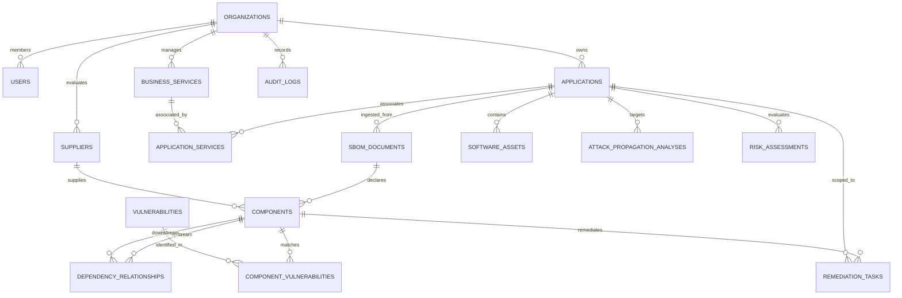

# Supply Chain Sentinel — Database Schema Design
**Database Engine:** PostgreSQL 16+ (with SQLite dialect compatibility for zero-dependency standalone execution)  
**ORM:** SQLAlchemy 2.0 (Declarative Mapping) with Alembic Migrations  
**Schema Version:** 1.0.0-Enterprise  

---

## 1. Entity-Relationship Overview

Supply Chain Sentinel's relational schema connects:
`Organization -> User -> Application -> BusinessService -> SoftwareAsset -> SBOMDocument -> Component -> DependencyRelationship -> Vulnerability -> AttackPropagationAnalysis -> RiskAssessment -> RemediationTask`



---

## 2. Core Tables and Data Dictionary

### 2.1 Multi-Tenancy & Identity

#### `organizations`
- `id`: UUID (Primary Key, default: `uuid_generate_v4()`)
- `name`: VARCHAR(255) (NOT NULL, UNIQUE)
- `slug`: VARCHAR(100) (NOT NULL, UNIQUE)
- `risk_policy`: JSONB (Default weighting configuration for risk calculation)
- `created_at`: TIMESTAMPTZ (DEFAULT NOW())
- `updated_at`: TIMESTAMPTZ (DEFAULT NOW())

#### `users`
- `id`: UUID (Primary Key)
- `org_id`: UUID (Foreign Key -> `organizations.id` ON DELETE CASCADE)
- `email`: VARCHAR(255) (NOT NULL, UNIQUE)
- `hashed_password`: VARCHAR(255) (NOT NULL, Argon2id/bcrypt hashed)
- `full_name`: VARCHAR(255) (NOT NULL)
- `role`: VARCHAR(50) (NOT NULL, Enum: `super_admin`, `org_admin`, `security_analyst`, `security_engineer`, `read_only_exec`)
- `is_active`: BOOLEAN (DEFAULT TRUE)
- `last_login`: TIMESTAMPTZ (NULLABLE)
- `created_at`: TIMESTAMPTZ (DEFAULT NOW())

### 2.2 Asset & Business Architecture

#### `business_services`
- `id`: UUID (Primary Key)
- `org_id`: UUID (Foreign Key -> `organizations.id`)
- `name`: VARCHAR(255) (e.g. "Core Payment Gateway", "Customer Facing Checkout")
- `criticality`: VARCHAR(50) (Enum: `MISSION_CRITICAL`, `BUSINESS_OPERATIONAL`, `INTERNAL_SUPPORT`, `LOW`)
- `financial_impact_rating`: DECIMAL(10, 2) (Estimated hourly disruption cost in USD)
- `owner_team`: VARCHAR(255)
- `created_at`: TIMESTAMPTZ

#### `applications`
- `id`: UUID (Primary Key)
- `org_id`: UUID (Foreign Key -> `organizations.id`)
- `name`: VARCHAR(255) (e.g. "payment-service", "checkout-web")
- `repository_url`: VARCHAR(1024)
- `environment`: VARCHAR(50) (Enum: `PRODUCTION`, `STAGING`, `DEVELOPMENT`, `TEST`)
- `business_criticality`: VARCHAR(50) (Enum: `CRITICAL`, `HIGH`, `MEDIUM`, `LOW`)
- `internet_exposed`: BOOLEAN (DEFAULT FALSE - crucial factor for blast radius)
- `active_sbom_id`: UUID (Nullable, points to latest verified SBOM)
- `current_risk_score`: DECIMAL(5, 2) (0.0 to 100.0)
- `created_at`: TIMESTAMPTZ
- `updated_at`: TIMESTAMPTZ

#### `application_services` (Association Table)
- `application_id`: UUID (Foreign Key -> `applications.id` ON DELETE CASCADE)
- `service_id`: UUID (Foreign Key -> `business_services.id` ON DELETE CASCADE)
- Primary Key: (`application_id`, `service_id`)

### 2.3 SBOM & Dependency Architecture

#### `sbom_documents`
- `id`: UUID (Primary Key)
- `application_id`: UUID (Foreign Key -> `applications.id` ON DELETE CASCADE)
- `format`: VARCHAR(50) (Enum: `CYCLONEDX_JSON`, `CYCLONEDX_XML`, `SPDX_JSON`)
- `spec_version`: VARCHAR(50) (e.g., "1.4", "1.5", "2.3")
- `serial_number`: VARCHAR(255) (Standardized URN or UUID)
- `version`: INTEGER (DEFAULT 1)
- `file_hash_sha256`: VARCHAR(64) (NOT NULL)
- `raw_content`: TEXT (Stored sanitized raw content for verification)
- `component_count`: INTEGER (DEFAULT 0)
- `dependency_count`: INTEGER (DEFAULT 0)
- `is_latest`: BOOLEAN (DEFAULT TRUE)
- `created_at`: TIMESTAMPTZ

#### `suppliers`
- `id`: UUID (Primary Key)
- `org_id`: UUID (Foreign Key -> `organizations.id`)
- `name`: VARCHAR(255) (e.g. "Apache Software Foundation", "Spring.io", "Vendor X")
- `contact_email`: VARCHAR(255)
- `trust_tier`: VARCHAR(50) (Enum: `TIER_1_VERIFIED`, `TIER_2_STANDARD`, `TIER_3_UNVERIFIED`, `HIGH_RISK`)
- `security_assessment_score`: DECIMAL(5, 2)
- `created_at`: TIMESTAMPTZ

#### `components`
- `id`: UUID (Primary Key)
- `sbom_id`: UUID (Foreign Key -> `sbom_documents.id` ON DELETE CASCADE)
- `purl`: VARCHAR(1024) (Standard Package URL: `pkg:maven/org.apache.logging.log4j/log4j-core@2.14.1`)
- `name`: VARCHAR(255) (NOT NULL)
- `version`: VARCHAR(100) (NOT NULL)
- `ecosystem`: VARCHAR(100) (Enum: `npm`, `maven`, `pypi`, `golang`, `cargo`, `nuget`, etc.)
- `supplier_id`: UUID (Nullable, Foreign Key -> `suppliers.id`)
- `license_declared`: VARCHAR(255)
- `is_direct`: BOOLEAN (DEFAULT TRUE - direct dependency vs. transitive)
- `depth`: INTEGER (DEFAULT 1 - depth in dependency tree)
- `created_at`: TIMESTAMPTZ

#### `dependency_relationships`
- `id`: UUID (Primary Key)
- `sbom_id`: UUID (Foreign Key -> `sbom_documents.id` ON DELETE CASCADE)
- `parent_component_id`: UUID (Foreign Key -> `components.id` ON DELETE CASCADE)
- `child_component_id`: UUID (Foreign Key -> `components.id` ON DELETE CASCADE)
- `relationship_type`: VARCHAR(50) (Enum: `DEPENDS_ON`, `CONTAINS`, `DEV_DEPENDENCY`, `OPTIONAL`)
- Index on (`parent_component_id`, `child_component_id`)

### 2.4 Vulnerability & Threat Intelligence

#### `vulnerabilities`
- `id`: VARCHAR(100) (Primary Key, e.g. "CVE-2021-44228", "GHSA-jfh8-c2jp-5v3q")
- `source`: VARCHAR(50) (Enum: `NVD`, `OSV`, `GITHUB_ADVISORY`, `CISA_KEV`)
- `title`: TEXT
- `summary`: TEXT
- `details`: TEXT
- `cvss_v3_score`: DECIMAL(3, 1) (0.0 - 10.0)
- `cvss_v3_vector`: VARCHAR(255)
- `severity`: VARCHAR(50) (Enum: `CRITICAL`, `HIGH`, `MEDIUM`, `LOW`, `UNKNOWN`)
- `epss_score`: DECIMAL(5, 4) (0.0000 - 1.0000 probability)
- `epss_percentile`: DECIMAL(5, 4)
- `is_cisa_kev`: BOOLEAN (DEFAULT FALSE - confirmed in CISA KEV catalog)
- `cisa_kev_due_date`: DATE (Nullable)
- `affected_packages`: JSONB (Structured version specifications & patch guidance)
- `published_at`: TIMESTAMPTZ
- `last_modified_at`: TIMESTAMPTZ
- `cached_at`: TIMESTAMPTZ (DEFAULT NOW())

#### `component_vulnerabilities`
- `id`: UUID (Primary Key)
- `component_id`: UUID (Foreign Key -> `components.id` ON DELETE CASCADE)
- `vulnerability_id`: VARCHAR(100) (Foreign Key -> `vulnerabilities.id` ON DELETE CASCADE)
- `verification_status`: VARCHAR(50) (Enum: `POTENTIAL_EXPOSURE`, `CONFIRMED_AFFECTED`, `MITIGATED_BY_CONFIGURATION`, `FALSE_POSITIVE`)
- `remediation_available`: BOOLEAN (DEFAULT TRUE)
- `fixed_version`: VARCHAR(100)
- `created_at`: TIMESTAMPTZ

### 2.5 Attack Propagation, Risk & Remediation

#### `attack_propagation_analyses`
- `id`: UUID (Primary Key)
- `org_id`: UUID (Foreign Key -> `organizations.id`)
- `originating_component_id`: UUID (Foreign Key -> `components.id`)
- `vulnerability_id`: VARCHAR(100) (Foreign Key -> `vulnerabilities.id`)
- `affected_application_count`: INTEGER
- `affected_business_service_count`: INTEGER
- `blast_radius_score`: DECIMAL(5, 2) (0.0 to 100.0)
- `propagation_paths`: JSONB (Array of traced graph paths from component to apps to services)
- `confidence_level`: VARCHAR(50) (Enum: `HIGH`, `MEDIUM`, `HEURISTIC`)
- `explainable_summary`: TEXT
- `analyzed_at`: TIMESTAMPTZ (DEFAULT NOW())

#### `risk_assessments`
- `id`: UUID (Primary Key)
- `application_id`: UUID (Foreign Key -> `applications.id` ON DELETE CASCADE)
- `overall_score`: DECIMAL(5, 2)
- `severity_breakdown`: JSONB (Scores by factor: CVSS, EPSS, KEV, Exposure, Criticality)
- `risk_tier`: VARCHAR(50) (Enum: `CRITICAL`, `HIGH`, `MEDIUM`, `LOW`)
- `primary_risk_drivers`: JSONB (Text explanations of key driving factors)
- `assessed_at`: TIMESTAMPTZ (DEFAULT NOW())

#### `remediation_tasks`
- `id`: UUID (Primary Key)
- `org_id`: UUID (Foreign Key -> `organizations.id`)
- `application_id`: UUID (Foreign Key -> `applications.id`)
- `component_id`: UUID (Foreign Key -> `components.id`)
- `vulnerability_id`: VARCHAR(100) (Foreign Key -> `vulnerabilities.id`)
- `title`: VARCHAR(255)
- `description`: TEXT
- `priority`: VARCHAR(50) (Enum: `URGENT`, `HIGH`, `MEDIUM`, `LOW`)
- `status`: VARCHAR(50) (Enum: `OPEN`, `IN_PROGRESS`, `AWAITING_VALIDATION`, `RESOLVED`, `RISK_ACCEPTED`, `REOPENED`)
- `assigned_team`: VARCHAR(255)
- `target_resolution_date`: DATE
- `verified_in_sbom_id`: UUID (Foreign Key -> `sbom_documents.id` - links to rescan verification)
- `compensating_controls`: TEXT
- `risk_acceptance_justification`: TEXT
- `created_at`: TIMESTAMPTZ
- `updated_at`: TIMESTAMPTZ

#### `security_alerts`
- `id`: UUID (Primary Key)
- `org_id`: UUID (Foreign Key -> `organizations.id`)
- `title`: VARCHAR(255)
- `message`: TEXT
- `severity`: VARCHAR(50) (Enum: `CRITICAL`, `HIGH`, `MEDIUM`, `INFO`)
- `entity_type`: VARCHAR(50) (Enum: `VULNERABILITY`, `KEV_UPDATE`, `SBOM_ANOMALY`, `REMEDIATION_OVERDUE`)
- `entity_id`: VARCHAR(255)
- `is_acknowledged`: BOOLEAN (DEFAULT FALSE)
- `acknowledged_by`: UUID (Nullable, Foreign Key -> `users.id`)
- `created_at`: TIMESTAMPTZ

#### `audit_logs`
- `id`: UUID (Primary Key)
- `org_id`: UUID (Foreign Key -> `organizations.id`)
- `user_id`: UUID (Nullable, Foreign Key -> `users.id`)
- `action`: VARCHAR(100) (e.g. `AUTH_LOGIN`, `SBOM_UPLOAD`, `REMEDIATION_STATUS_CHANGE`, `AI_QUERY`)
- `target_resource`: VARCHAR(255)
- `ip_address`: VARCHAR(45)
- `details`: JSONB
- `timestamp`: TIMESTAMPTZ (DEFAULT NOW())

---

## 3. Database Indexes for High-Performance Graph Queries

```sql
-- Fast component lookup by PURL and name
CREATE INDEX idx_components_purl ON components(purl);
CREATE INDEX idx_components_name_eco ON components(name, ecosystem);
CREATE INDEX idx_components_sbom ON components(sbom_id);

-- Dependency relationship traversal indexes
CREATE INDEX idx_dep_parent ON dependency_relationships(parent_component_id);
CREATE INDEX idx_dep_child ON dependency_relationships(child_component_id);
CREATE INDEX idx_dep_sbom ON dependency_relationships(sbom_id);

-- Vulnerability lookup and KEV filtering
CREATE INDEX idx_vuln_sev ON vulnerabilities(severity);
CREATE INDEX idx_vuln_kev ON vulnerabilities(is_cisa_kev);
CREATE INDEX idx_vuln_epss ON vulnerabilities(epss_score);

-- Multi-tenancy isolation indexes
CREATE INDEX idx_apps_org ON applications(org_id);
CREATE INDEX idx_services_org ON business_services(org_id);
CREATE INDEX idx_audit_org_time ON audit_logs(org_id, timestamp DESC);
```
